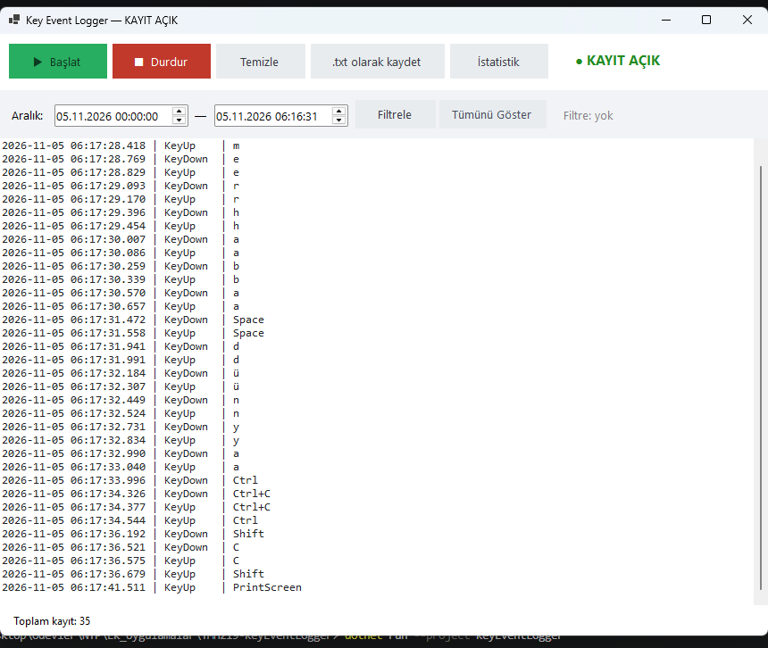
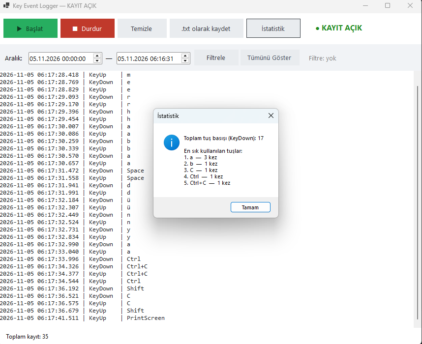
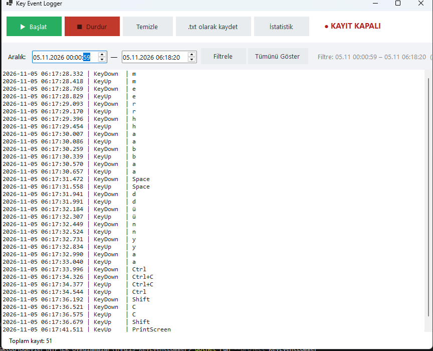
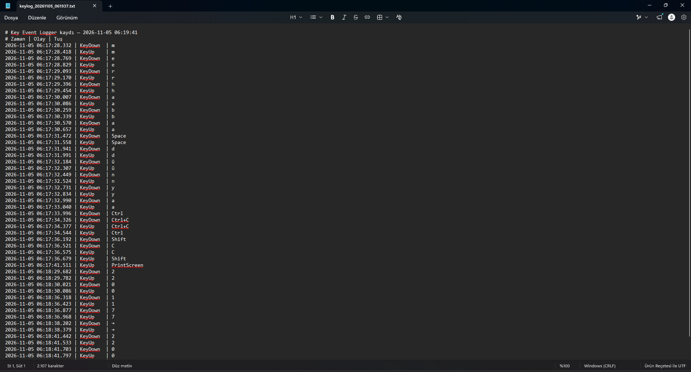

# YMH219 — Key Event Logger (Eğitsel)

Nesne Tabanlı Programlama (YMH 219) dersi ek uygulama ödevi. Klavye olaylarının nasıl
yakalandığını ve olay bilgilerinin uygulama içinde nasıl işlendiğini gösteren bir
**Windows Forms** uygulamasıdır. Uygulama **yalnızca kendi penceresi aktifken** basılan
tuşları, zaman bilgisiyle birlikte listeler ve isteğe bağlı olarak bir `.txt` dosyasına kaydeder.

> ⚠️ **Kapsam ve güvenlik sınırı:** Bu uygulama gerçek bir sistem keylogger'ı **değildir**.
> Olaylar yalnızca uygulamanın kendi penceresi odaktayken yakalanır. Global klavye hook'u,
> gizli/arka plan çalışması, başlangıçta otomatik çalışma, parola/kimlik bilgisi yakalama,
> başka uygulamalardan veri toplama ve kayıtları ağ üzerinden gönderme gibi davranışların
> **hiçbiri yoktur**. Tamamen eğitim amaçlıdır.

## Kullanılan Teknolojiler

- **C# / .NET 8** (`net8.0-windows`)
- **Windows Forms** (masaüstü arayüz)
- Ek **NuGet paketi kullanılmamıştır** (yalnızca .NET'in yerleşik kütüphaneleri)
- Klavye düzenine göre karakter çözümlemesi için `user32.dll` içinden `ToUnicodeEx` /
  `MapVirtualKeyEx` (yalnızca tuş→karakter çevirisi; dinleme/hook değildir)

## Temel Özellikler

- **Başlat / Durdur** ile kayıt durumunun kontrolü; renkli bir **durum göstergesi** (● KAYIT AÇIK/KAPALI)
- Basılan tuşun **adı ve zaman bilgisi** (milisaniye dâhil) anında listelenir; hem `KeyDown` hem `KeyUp`
- **Türkçe karakter desteği** (ş, ğ, ü, ö, ç, ı, i, İ) ve doğru büyük/küçük harf
- **Ctrl / Shift / Alt** kombinasyonları ("Ctrl+C", "Shift+A" gibi) ve özel tuşlar (Enter, Space, ←, F5 …)
- **Temizle** (onay sorar) ile ekrandaki kayıtların silinmesi
- **.txt olarak kaydet**: `SaveFileDialog` ile seçilen dosyaya UTF-8 kodlamasıyla kayıt
- **İstatistik**: toplam tuş basışı ve en sık kullanılan tuşlar
- **Tarih/saat aralığına göre filtreleme**
- Kaydedilmemiş kayıtlar varken pencere kapatılırken **uyarı**

## Kurulum ve Çalıştırma

**Gereksinimler:** Windows ve [.NET 8 SDK](https://dotnet.microsoft.com/download) (veya Visual Studio 2022).

**Visual Studio ile:**
1. `KeyEventLogger.sln` dosyasını Visual Studio 2022 ile açın.
2. **F5** ile çalıştırın.

**Komut satırı ile:**
```bash
dotnet run --project KeyEventLogger
```

## Nasıl Kullanılır

1. **Başlat**'a basın (gösterge yeşil "● KAYIT AÇIK" olur).
2. Pencere aktifken yazın; her tuş olayı listede görünür.
3. **Durdur** ile kaydı durdurun.
4. İsterseniz **.txt olarak kaydet** ile kayıtları dosyaya yazın, **İstatistik** ile özet görün
   veya tarih/saat aralığı seçip **Filtrele**'yi kullanın.

## Ekran Görüntüleri

**Kayıt sırasında ana ekran**


**İstatistik (toplam ve en sık tuşlar)**


**Tarih/saat aralığına göre filtreleme**


**Kaydedilen .txt dosyası**


## Proje Yapısı (Nesne Tabanlı Tasarım)

Sorumluluklar ayrı sınıflara bölünmüştür:

| Dosya | Sorumluluk |
|-------|------------|
| `KeyEventRecord.cs` | Tek bir klavye olayını (zaman, olay türü, tuş) temsil eden değişmez veri sınıfı |
| `KeyLogSession.cs` | Kayıt durumu ve kayıt listesinin yönetimi; değişiklikleri olaylarla (event) bildirir |
| `LogFileWriter.cs` | Kayıtların `.txt` dosyasına yazılması |
| `KeyStatistics.cs` | Toplam ve en sık tuş istatistiğinin (LINQ ile) hesaplanması |
| `MainForm.cs` | Arayüz: butonları oturuma yönlendirir, olaylarla ekranı günceller, tuşları yakalar |

## Bilinen Sınırlamalar / Notlar

- Uygulama **yalnızca kendi penceresi aktifken** tuş yakalar (tasarım gereği; güvenlik sınırı).
- Tuş→karakter çözümlemesi **geçerli klavye düzenine** (Türkçe Q) göredir.
- Bir özel/Türkçe tuşa programda **ilk kez doğrudan Ctrl ile** basıldığında, o tuş daha önce
  normal yazılmadıysa, karakter temel (shift'siz) biçimiyle gösterilebilir.
- Hızlı yazarken tuş olaylarının üst üste binmesi (ör. bir tuşun KeyUp'ından önce diğerinin
  KeyDown'ı) normaldir; gerçekte olan olaylar olduğu gibi kaydedilir.

## Öğrenci

- **Ad Soyad:** Emirhan LEVENTER
- **Öğrenci No:** 250542004
